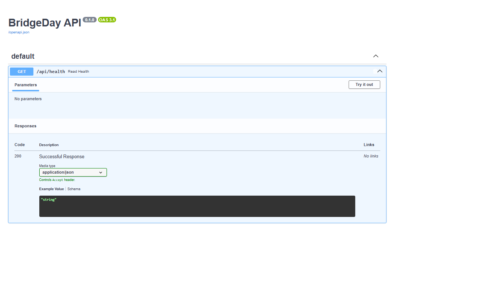
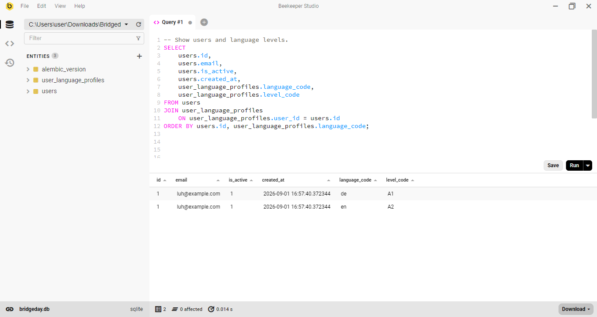
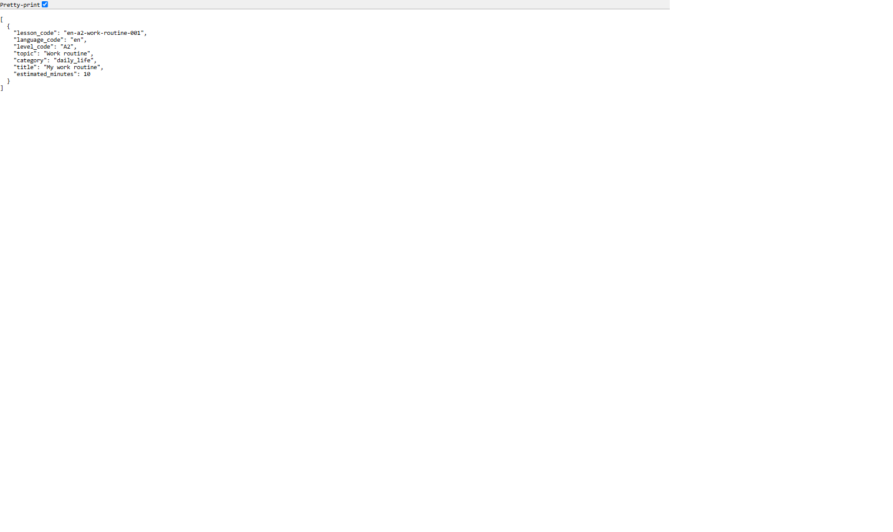
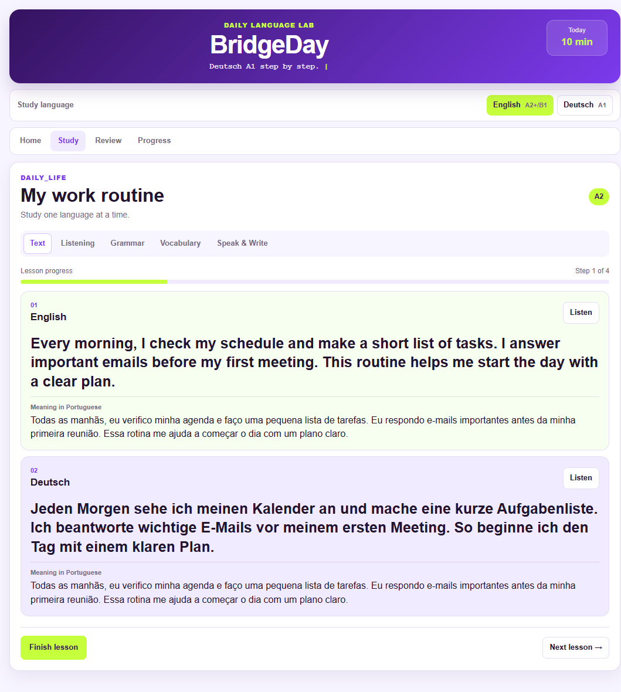
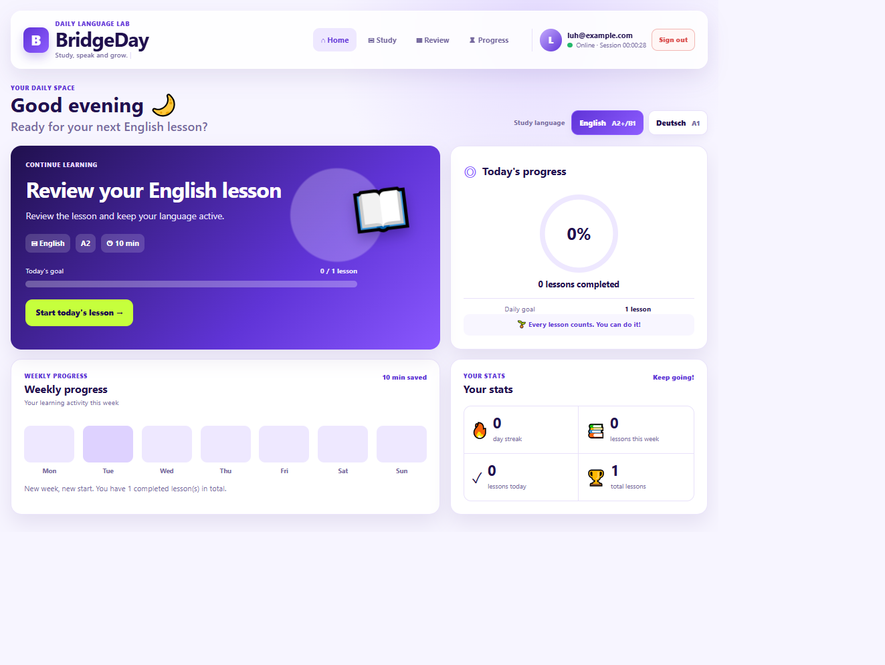

# BridgeDay — Daily Language Lab

BridgeDay is a local app for daily **English** and **German** study.

It has short lessons, vocabulary, exercises, writing, progress by language, and spaced review.

## Current status

The local MVP is working.

- Login and user session.
- Separate English A2 and German A1 tracks.
- Lessons with text, listening, grammar, vocabulary, and speaking/writing.
- `fill_blank` exercises with correction and saved attempts.
- Progress and history for each language.
- Spaced review after 1, 3, 7, 14, and 30 days.
- Import of reviewed lesson batches.
- Responsive mobile layout.
- Local SQLite database not tracked by Git.

## MVP

MVP means **Minimum Viable Product**.

BridgeDay already lets a learner:

1. Create an account and sign in.
2. Choose English or German.
3. Study real lessons.
4. Answer exercises and see corrections.
5. Save a written answer.
6. Complete lessons.
7. See progress for each language.
8. Review lessons when they are ready.

## Technologies

| Area | Technology |
| --- | --- |
| Front-end | HTML, CSS, JavaScript |
| Back-end | Python, FastAPI |
| Database | SQLite |
| Database ORM | SQLAlchemy |
| Database migrations | Alembic |
| Login security | JWT, Passlib, bcrypt |
| API documentation | FastAPI Swagger Docs |
| Version control | Git and GitHub |

## Project structure

```text
Bridgeday_language_lab/
├── front/                  # Learner interface
├── backend/                # FastAPI application
├── data/
│   ├── bridgeday.db        # Active SQLite database
│   └── batches/            # Reviewed lesson batches
├── scripts/                # Import tools
├── .env                    # Private settings
├── .gitignore
├── alembic.ini
└── README.md
```

## Start the project

Open two terminals in the main project folder:

```text
C:\Users\user\Downloads\Bridgeday_language_lab
```

### Start the front-end

```powershell
# Serve the front folder for the browser.
.\.venv\Scripts\python.exe -m http.server 5500 --directory front
```

Open:

```text
http://localhost:5500
```

### Start the back-end

```powershell
# Start the API server and reload after Python changes.
.\.venv\Scripts\python.exe -m uvicorn backend.app.main:app --reload
```

Open API documentation:

```text
http://127.0.0.1:8000/docs
```

## Database

The active database is:

```text
data\bridgeday.db
```

Do not delete this file.

It stores users, language profiles, lessons, translations, vocabulary, exercises, attempts, progress, reviews, and writing entries.

## Available content

| Language | Level | Lessons |
| --- | --- | ---: |
| German | A1 | 16 |
| English | A2 | 17 |
| **Total** | — | **33** |

Imported batches:

```text
data\batches\de-a1-batch-02.json
data\batches\en-a2-batch-02.json
```

## Validate a lesson batch

```powershell
# Validate JSON without changing the database.
.\.venv\Scripts\python.exe -m json.tool data\batches\BATCH-NAME.json | Out-Null
```

## Import a lesson batch

```powershell
# Import only lesson codes that do not exist yet.
.\.venv\Scripts\python.exe scripts\import_lessons.py --file data\batches\BATCH-NAME.json
```

## Spaced review

A completed lesson can appear again after:

```text
1 day → 3 days → 7 days → 14 days → 30 days
```

A learner cannot complete a review before its planned date.

## Completed checks

- API starts without errors.
- SQLite database is connected.
- Database migrations are applied.
- Login was tested.
- Lessons load from the API.
- Correct and wrong exercise answers were tested.
- Exercise attempts are saved.
- Progress history works by language.
- Early reviews are blocked.
- English and German lesson batches were imported.
- Mobile navigation was tested.
- Local database files are ignored by Git.

## Future work

1. Add more reviewed lesson batches.
2. Add automated API tests.
3. Add multiple-choice exercises.
4. Add word-order exercises.
5. Add audio-comprehension exercises.
6. Improve profile and password recovery.
7. Prepare public deployment.


________________________________________

<h4 align="center">Img Project - Bridgeday_language_lab 🥰 🚀</h4>

<div align="center">
    <table>
        <tr>
            <td style="width: 50%; text-align: center;">
                
                <p style="margin-top: 5px;">Front_127.0.0.1_8000_docs</p>
            </td>
            <td style="width: 50%; text-align: center;">
                
                <p style="margin-top: 5px;">Users_user_language_profiles_BeekeeperStudio</p>
            </td>
        </tr>
    </table>
</div>

  <br/>
  <br/>

________________________________________

<h4 align="center">Img Project - Bridgeday_language_lab 🥰 🚀</h4>

<div align="center">
    <table>
        <tr>
            <td style="width: 50%; text-align: center;">
                
                <p style="margin-top: 5px;">Apply the migration_Beekeeper-Studio</p>
            </td>
            <td style="width: 50%; text-align: center;">
                
                <p style="margin-top: 5px;">127.0.0.1_8000_api_lessons_language=en&level=A2</p>
            </td>
        </tr>
    </table>
</div>

  <br/>
  <br/>

________________________________________

<h4 align="center">Img Project - Bridgeday_language_lab 🥰 🚀</h4>

<div align="center">
    <table>
        <tr>
            <td style="width: 50%; text-align: center;">
                
                <p style="margin-top: 5px;">localhost_5500_index_Study</p>
            </td>
            <td style="width: 50%; text-align: center;">
                
                <p style="margin-top: 5px;">Show the new progress tables_Beekeeper</p>
            </td>
        </tr>
    </table>
</div>

  <br/>
  <br/>
________________________________________

<h4 align="center">Img Project - Bridgeday_language_lab 🥰 🚀</h4>

<div align="center">
    <table>
        <tr>
            <td style="width: 50%; text-align: center;">
                
                <p style="margin-top: 5px;">127.0.0.1_8000_docs_Progress com POST api_progress_complete</p>
            </td>
            <td style="width: 50%; text-align: center;">
                
                <p style="margin-top: 5px;">The result was saved in SQLite_Beekeeper-Studio</p>
            </td>
        </tr>
    </table>
</div>

  <br/>
  <br/>
________________________________________

<h4 align="center">Img Project - Bridgeday_language_lab 🥰 🚀</h4>

<div align="center">
    <table>
        <tr>
            <td style="width: 50%; text-align: center;">
                
                <p style="margin-top: 5px;">New_Front_localhost_5500</p>
            </td>
            <td style="width: 50%; text-align: center;">
                
                <p style="margin-top: 5px;">Show all lessons saved in BridgeDay_Beekeeper-Studio</p>
            </td>
        </tr>
    </table>
</div>

  <br/>
  <br/>
________________________________________


---

### Versão em Português

# BridgeDay — Daily Language Lab

BridgeDay é um aplicativo local de aprendizagem diária para **English** e **Deutsch**.

O projeto oferece lições curtas, vocabulário, exercícios, escrita, progresso por idioma e revisão espaçada.

## Status

O MVP local está funcional.

- Login e sessão.
- Trilhas separadas: English A2 e Deutsch A1.
- Lições com texto, listening, grammar, vocabulary e speak & write.
- Exercícios `fill_blank` com correção e registro de tentativas.
- Progresso e histórico separados por idioma.
- Revisão espaçada em 1, 3, 7, 14 e 30 dias.
- Importação de lições revisadas em lote.
- Layout responsivo para celular.
- Banco SQLite local protegido do Git.

## MVP

MVP significa **Minimum Viable Product**: a menor versão útil e funcional de um produto.

O BridgeDay já permite que uma pessoa:

1. Crie uma conta e entre.
2. Escolha English ou Deutsch.
3. Estude lições reais.
4. Responda exercícios e veja a correção.
5. Salve uma resposta escrita.
6. Conclua lições.
7. Consulte progresso por idioma.
8. Faça revisões quando elas estiverem disponíveis.

## Tecnologias

| Área | Tecnologia |
| --- | --- |
| Front-end | HTML, CSS e JavaScript |
| Back-end | Python e FastAPI |
| Banco de dados | SQLite |
| ORM | SQLAlchemy |
| Migrações | Alembic |
| Autenticação | JWT, Passlib e bcrypt |
| Documentação da API | FastAPI Swagger Docs |
| Versionamento | Git e GitHub |

## Estrutura do projeto

```text
Bridgeday_language_lab/
├── front/                  # Interface mostrada ao aluno
│   ├── index.html
│   ├── styles.css
│   ├── app.js
│   └── js/
│       └── exercises.js
├── backend/                # API FastAPI
│   ├── app/
│   │   ├── api/
│   │   ├── core/
│   │   ├── models/
│   │   ├── schemas/
│   │   ├── services/
│   │   ├── database.py
│   │   └── main.py
│   └── migrations/
│       └── versions/
├── data/
│   ├── bridgeday.db        # Banco SQLite ativo
│   └── batches/            # Lotes JSON de lições revisadas
├── scripts/                # Importadores e utilitários manuais
├── .env                    # Configurações privadas
├── .gitignore
├── alembic.ini
└── README.md
```

## Como iniciar o projeto

Abra dois terminais na pasta principal do projeto:

```text
C:\Users\user\Downloads\Bridgeday_language_lab
```

### 1. Iniciar o front-end

```powershell
# Serve the exact front folder used by the browser.
.\.venv\Scripts\python.exe -m http.server 5500 --directory front
```

Abra no navegador:

```text
http://localhost:5500
```

### 2. Iniciar o back-end

```powershell
# Start the FastAPI server and reload it after Python changes.
.\.venv\Scripts\python.exe -m uvicorn backend.app.main:app --reload
```

A API ficará disponível em:

```text
http://127.0.0.1:8000
```

A documentação interativa da API ficará em:

```text
http://127.0.0.1:8000/docs
```

## Banco de dados

O único banco ativo do projeto é:

```text
data\bridgeday.db
```

Não apague esse arquivo.

O banco guarda, entre outros dados:

- usuários;
- perfis de idioma;
- lições;
- traduções;
- vocabulário;
- exercícios;
- tentativas de exercícios;
- progresso das lições;
- revisões;
- textos escritos pelo usuário.

## Segurança local

O banco SQLite, ambiente virtual e configurações privadas não devem entrar no Git.

O `.gitignore` inclui:

```gitignore
# Ignore local databases and SQLite support files.
*.db
*.db-shm
*.db-wal

# Ignore local Python and private configuration files.
.venv/
**/__pycache__/
.env
```

## Conteúdo disponível

| Idioma | Nível | Lições |
| --- | --- | ---: |
| Deutsch | A1 | 16 |
| English | A2 | 17 |
| **Total** | — | **33** |

Lotes já importados:

```text
data\batches\de-a1-batch-02.json
data\batches\en-a2-batch-02.json
```

Cada lição possui:

- código único;
- idioma e nível;
- texto principal;
- traduções revisadas;
- nota gramatical;
- vocabulário;
- exercício `fill_blank`.

## Validar um lote de lições

```powershell
# Validate JSON syntax without changing the database.
.\.venv\Scripts\python.exe -m json.tool data\batches\NOME-DO-LOTE.json | Out-Null

# Show success only after valid JSON syntax.
if ($LASTEXITCODE -eq 0) {
    Write-Host "JSON valid."
}
```

## Importar um lote de lições

```powershell
# Import only lesson codes that do not already exist in SQLite.
.\.venv\Scripts\python.exe scripts\import_lessons.py --file data\batches\NOME-DO-LOTE.json
```

O importador ignora códigos de lições que já existem no banco.

## Revisão espaçada

Depois que uma lição é concluída, ela entra no ciclo de revisão:

```text
1 dia → 3 dias → 7 dias → 14 dias → 30 dias
```

Uma revisão não pode ser concluída antes da data prevista. A API retorna `409 Conflict` quando alguém tenta concluir uma revisão antecipadamente.

## Migrações do banco

A migração atual é:

```text
b883e40f21a4 (head)
```

Para conferir:

```powershell
# Show the migration applied to the active SQLite database.
.\.venv\Scripts\python.exe -m alembic current
```

Para aplicar novas migrações:

```powershell
# Apply every migration not yet applied to the local database.
.\.venv\Scripts\python.exe -m alembic upgrade head
```

## Verificações concluídas

- API iniciada sem erros.
- Banco SQLite conectado.
- Migrações aplicadas.
- Login testado.
- Lição diária carregada pela API.
- Exercícios testados com respostas certas e erradas.
- Tentativas salvas no banco.
- Histórico por idioma testado.
- Revisão antecipada bloqueada corretamente.
- Lotes German A1 e English A2 validados e importados.
- Responsividade testada em tela de celular.
- Menu mobile com Home, Study, Review e Progress acessíveis.
- Banco local removido do controle do Git.

## Próximas evoluções

1. Criar novos lotes de lições revisadas.
2. Adicionar testes automatizados para a API.
3. Adicionar exercícios de múltipla escolha.
4. Adicionar exercícios de ordenar palavras.
5. Adicionar compreensão de áudio.
6. Melhorar perfil e recuperação de senha.
7. Criar validações adicionais.
8. Preparar deploy público.

## Arquitetura de exercícios

```text
Exercise engine
├── fill_blank               # Implementado
├── multiple_choice          # Futuro
├── word_order               # Futuro
└── audio_comprehension      # Futuro
```

## Arquitetura de conteúdo

```text
Content
├── English lessons
├── Deutsch lessons
└── Future languages
```

## Licença

Projeto em desenvolvimento para fins educacionais e de portfólio.

________________________________________


---------

#### 🤝 Contributing
If you would like to contribute to this project, feel free to open an issue or submit a pull request! 🚀
________________________________________
#### 📜 License
This project is licensed under the MIT License - see the LICENSE file for details.
👩💻 Developed with 💙 by [[LuDiemert](https://www.linkedin.com/in/lucianadiemert/)]

________________________________________
- #### My LinkedIn - [](https://www.linkedin.com/in/lucianadiemert/)

________________________________________
## 🌐 **Contact**


#### [**Luciana Diemert**](https://github.com/ludiemert)

🛠 Full-Stack Developer <br>
🖥️ Python | Computer Vision | AI Integrations <br>
📍 Cork - Irland
☎ +353 87 243 8690

<a href="https://www.linkedin.com/in/lucianadiemert" target="_blank"></a>&nbsp;
<a href="mailto:lucianadiemert@gmail.com" target="_blank"></a>&nbsp;
<a href="#"></a>&nbsp;
<a href="https://www.github.com/ludiemert" target="_blank"></a>&nbsp;

<br clear="left"/>

---
Developed with ❤ by [ludiemert](https://github.com/ludiemert).

